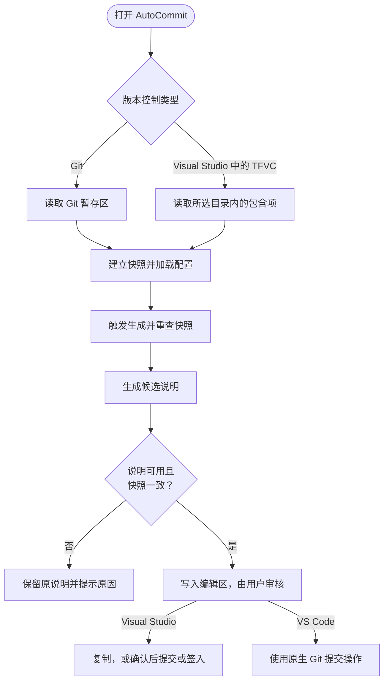
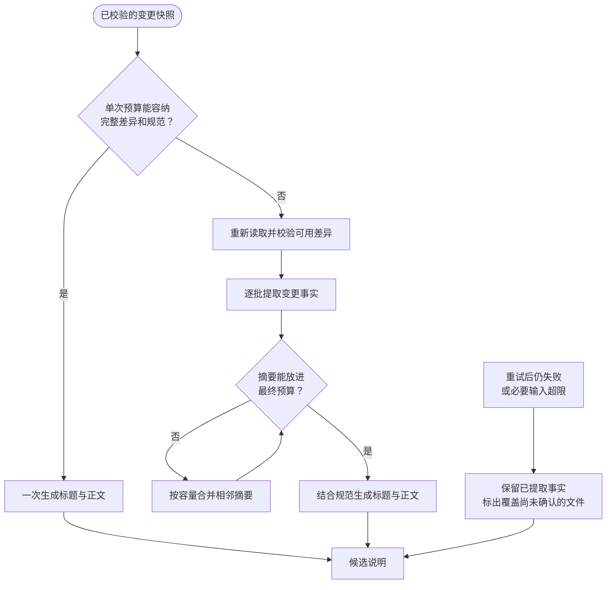

# AutoCommit 运行逻辑

本文描述 v1.0.0 的生成和签入流程。安装入口、构建和发布命令见[项目 README](../README.md)。

## 总体流程

| 平台 | 运行入口 | 变更来源 | 提交方式 |
| --- | --- | --- | --- |
| Visual Studio 2019、2022 17.14 | 「工具 → AutoCommit 提交助手」 | Git 暂存区，或 Team Explorer 的 TFVC 包含项 | 可复制说明，也可确认后执行本地 Git 提交或 TFVC 服务器签入 |
| VS Code 桌面版 | 源代码管理视图或「AutoCommit: 生成提交说明」命令；也可运行固定示例生成命令测试模型 | VS Code 内置 Git 扩展提供仓库列表，AutoCommit 通过 Git 命令读取暂存区；示例命令使用固定差异 | 写入原生源代码管理提交框，由用户发起提交；示例结果只显示通知，不读取仓库内容 |

## 确定变更范围

### Git

Visual Studio 从当前项目、解决方案或活动文件查找 Git 根目录，也支持手工指定。检测到多个选中项目属于不同仓库时，会提示选定一个仓库。VS Code 从内置 Git 扩展取得已打开的仓库，有多个时请用户选择。

两端都用 `git diff --cached` 取暂存差异。部分暂存时，只分析暂存的代码。快照指纹包含仓库状态、暂存索引和完整差异的摘要。读取前后会核对状态和索引，遇到未解决的合并冲突会提示先处理冲突。

在 VS Code 中，已有暂存内容时，触发生成即发送该范围的差异。暂存区为空且有变更时，会询问是否暂存全部变更并生成。确认后先检查暂存状态，再暂存修改、删除和未被 Git 忽略的新增文件，然后读取新的暂存快照。

生成前后的快照必须一致。Visual Studio 通过插件提交时会再检查一次，确认后执行本地 `git commit`，保留 Git hooks 和签名设置。推送由用户另行操作。

### TFVC

Visual Studio 在找不到 Git 根目录时尝试 TFVC。先在 Team Explorer 打开「挂起的更改」并等待列表加载，再把要处理的文件放入「包含的更改」。AutoCommit 读取的是**当前 Team Explorer 工作区的包含项与所选目录范围的交集**，目录范围包括子目录。手工填入上级目录前，该目录需映射到当前工作区。

插件按包含清单查询具体的挂起项，下载工作区基线，并读取需要比较的本地文件。文本按行生成统一 diff，新增、删除、重命名和目录操作保留对应的文件信息。对于二进制、无法按支持编码解码的内容、超过 1 MiB 的单个文件版本或超过差异计算规模的文本，使用路径、操作和可取得的大小等信息参与汇总。仍使用变更身份和完整文件内容的哈希来检查快照。

例如，选 `Source/StructGraph` 时，只读取该目录内的包含项。若要同时读取 `StructGraph` 和 `FeaCalc`，手工选择已映射的共同上级目录 `Source`，再点「读取变更」。放在「排除的更改」里的文件不会进入读取或签入清单。

从插件签入前，用户需确认文件清单和说明。插件复查快照及包含项，使用 TFVC SDK 检查冲突、必填说明和团队策略，然后用已验证的变更列表调用服务器签入。需要补充团队策略要求或走门控签入流程时，可把说明复制到 Team Explorer 处理。

## 配置、默认规范与凭据

| 项目 | 读取位置和优先级 |
| --- | --- |
| 模型设置 | Git 使用仓库根目录，TFVC 使用所选范围目录。`.auto/model.json` 可保存 `BaseUrl`、`Model`、`AllowHttp`、`MaxInputCharacters` 和可选的 `EnableThinking`。Visual Studio 找不到项目配置时使用本机默认设置，VS Code 用项目文件中的字段覆盖编辑器设置。 |
| 提交规范 | 优先读取 `.auto/commit-rules.md`，找不到时使用扩展内置规范。Visual Studio 允许临时编辑本次生成规范。持久修改直接保存到项目文件。 |
| 默认规范 | 标题概括整次提交的主要改动，涉及多个独立模块时在正文分条列出关键变化。这条规则也已同步到本仓库的 `.auto/commit-rules.md`。已有项目按自己的规则文件生成。 |
| API Key | Visual Studio 用 Windows DPAPI 按当前用户加密，VS Code 用独立的 SecretStorage。各编辑器按服务地址共享，项目专用 Key 优先，也可显式选择不发送 Key。 |

Visual Studio 读取变更时不创建 `.auto`。首次保存项目配置时按需初始化文件。如果已有旧版 `.commit-rules.md`，则优先将它用作新项目规则的初始内容。Visual Studio 和 VS Code 的本地凭据分别设置。

模型调用使用配置的 OpenAI 兼容 `chat/completions` 接口。HTTP 地址需显式允许，请求不跟随重定向。测试连接只发送固定文本。生成时才发送所选差异或文件信息，以及相应阶段所需的规则或摘要。

## 分批生成与合并

`MaxInputCharacters` 默认为 **48,000**，约束每次请求的系统提示和序列化后的用户消息长度，单位为 UTF-16 代码单元。实际模型有自己的 Token 上限。Git 和 TFVC 的本地预览最多保留约 200 万字符的差异正文，TFVC 还按文件分配预览空间。分批生成会从所选范围重新获取完整可用差异并暂存在本机临时文件，所以实际分批发送的差异可以多于界面显示的预览。临时文件随本次操作清理。

1. **一次生成。** 差异完整且符合预算时，请求包含 `stagedDiff` 和 `commitRules`，模型直接返回一份说明。
2. **分批提取。** 按行打包差异，遇到超长行可继续拆分。在预算允许时重复文件或差异块的标题，给续批保留上下文。每批只提取变更事实。
3. **逐层合并。** 文件事实带有本次快照内的编号与差异头。小文件可以合并提取，返回的编号会逐项校验。只在最终请求装不下当前事实时压缩相邻摘要，合并结果要覆盖来源编号。最后一次请求发送 `changeSummaries` 和 `commitRules`。
4. **审核结果。** 标题和正文基于汇总事实生成。内置规范要求标题概括整次提交，建议在 72 字符内表达主要改动，正文按模块说明关键变化。多批次摘要会压缩细节，各模块的覆盖情况由用户审核。

分批可以增加调用次数和耗时，进度区会显示处理阶段。每次模型请求默认等待 240 秒，可在项目 .auto/model.json 中通过 `RequestTimeoutSeconds` 设置为 1 至 300 秒。小差异直接生成、摘要合并和最终生成超时时，插件会重试当前请求一次，整次生成可手动取消。直接生成超时时，较大的完整差异转入分批汇总。提取批次超时后，插件会将该批及后续大批次按更小的预算拆分，并将已完成的摘要继续用于合并。同一批差异最多因超时向下拆分两层，每次对半缩小，拆分后的差异预算至少为 1,024 字符。超时提示显示阶段、输入大小、耗时，以及服务端返回的 HTTP 408 或 504（如有）。

成功时按本次生成汇总服务商返回的 Token 用量。请求超时时该次用量未知，因此即使重试后生成成功，也会将整轮 Token 合计标为未知。

## 运行日志

VS Code 在「输出」面板的 AutoCommit 日志通道记录运行信息。Visual Studio 在「模型设置 → 查看运行日志」打开本机日志目录。日志按运行编号记录快照读取、复查、模型阶段、每次请求的输入字符数与耗时、超时次数和回退原因。日志省略凭据、差异正文和模型输出。Visual Studio 的 generation.log 达到 1 MiB 时轮换，保留上一份。

## 本地摘要与草稿保护

- 缩小批次后仍超时、合并或最终请求超时、服务返回错误，或预算装不下必要内容时，已有事实会进入标有「部分摘要」的候选稿，并列出覆盖尚待确认的文件。没有已提取事实时按清单生成本地摘要。替换已有说明前会再次确认。模型配置校验错误会直接提示。
- 生成前后的快照有变化、用户取消或拒绝替换时，保留原说明。Visual Studio 将草稿和对应的快照一起保存在工具窗口内存中，并支持撤销最近一次替换。
- Visual Studio 提交前再次检查草稿与当前变更是否匹配。VS Code 回填后由用户使用原生 Git 操作，如果之后调整了暂存范围，应重新生成。

## 源码导航

| 职责 | 入口 |
| --- | --- |
| Visual Studio 菜单及工具窗口 | [AutoCommitPackage.cs](../src/AutoCommit.Vsix/AutoCommitPackage.cs)、[CommitControl.cs](../src/AutoCommit.Vsix/CommitControl.cs) |
| Visual Studio 仓库识别及变更读取 | [RepositoryDiscovery.cs](../src/AutoCommit.Vsix/RepositoryDiscovery.cs)、[Changes.cs](../src/AutoCommit.Core/Changes.cs)、[TfvcProvider.cs](../src/AutoCommit.Vsix/TfvcProvider.cs)、[TfvcContent.cs](../src/AutoCommit.Core/TfvcContent.cs) |
| Visual Studio 配置和生成 | [ProjectConfiguration.cs](../src/AutoCommit.Core/ProjectConfiguration.cs)、[Generation.cs](../src/AutoCommit.Core/Generation.cs)、[BatchSummarizer.cs](../src/AutoCommit.Core/BatchSummarizer.cs) |
| VS Code 命令、Git 快照、模型和分批 | [extension.js](../src/AutoCommit.Vscode/extension.js)、[core.js](../src/AutoCommit.Vscode/lib/core.js)、[batch.js](../src/AutoCommit.Vscode/lib/batch.js) |

v1.0.0 发布时，33 项 .NET 测试和 19 项 VS Code 测试通过。测试覆盖真实 Git 暂存差异、超过 32 MiB 的差异捕获、预算内分批和摘要合并、超时重试与缩小批次、模型失败兜底、取消，以及 VS Code 空暂存区确认和暂存状态变化处理。模型调用使用模拟响应；本次发布未完成编辑器 GUI、真实模型服务和 TFVC 服务器联调。发布说明见 [v1.0.0 发布记录](../releases/1.0.0/RELEASE_NOTES.md)。
